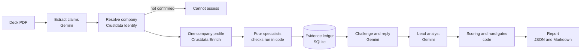

# Leo

**Leo checks every claim in a startup's pitch deck against independent company data and gives an invest-or-pass verdict, with the evidence for each finding.**

Built by Ayush and Daksh at ContextCon 03, on Crustdata's company graph.

## The service

**What it takes on:** due diligence on a pitch deck. Someone reads the deck, picks out the numbers the founders state (founding year, team size, money raised, ARR, growth, traction), and checks them against outside sources.

**Who does that job today:** a junior analyst or associate at a venture fund, angel group or accelerator, by hand, across a handful of browser tabs. At high volume (hundreds of decks in a batch) most decks only get skimmed, so inflated numbers slip through.

**Who pays:** the investing firm, in analyst time. Leo is aimed at the person who has to decide which decks deserve a founder call and how large a first check could be.

## What it does now

You give Leo a deck (PDF), the company's domain and your maximum check size. It returns a saved report and a verdict. End to end, with no person in the loop:

1. Reads the deck and extracts every testable claim (Gemini, with a Qwen fallback).
2. Resolves the company in Crustdata. If it can't confirm exactly one company, it stops with **cannot assess**; it never guesses.
3. Pulls one enriched company profile, then four specialists (identity, funding, traction, team) check each claim against it. Each finding cites evidence IDs and source dates.
4. The specialists challenge each other and reply; a lead analyst rules on open disputes and writes a summary.
5. A fixed scoring formula turns the saved findings into a verdict (`INVEST`, `INVEST WITH CONDITIONS`, `DIG DEEPER` or `PASS`) and a policy-based check size. A confirmed **hard gate** (for example, a revenue claim more than 3x the top of Crustdata's estimate) forces a pass.
6. Produces a JSON and Markdown report: claims table, evidence, scoring calculation, debate, limitations, and what you still need to obtain.

Use it from the web page at `http://127.0.0.1:8000/` or from the CLI.

### Measured on the three demo decks (real Gemini and Crustdata, 31 Oct 2026)

| Deck (`demo/decks/`) | Result | What happened |
|---|---|---|
| `01_honest_retool.pdf` | `INVEST WITH CONDITIONS`, about $45,000 to $47,000 of a $100,000 limit | Every figure matches Crustdata; 17 findings verified, credibility 100 |
| `02_inflated_retool.pdf` | **`PASS`, $0** | 10 claims contradicted, credibility 7.8; the `arr_ratio_over_3` gate fires |
| `03_fake_company_orrery.pdf` | **`CANNOT ASSESS`** | No company can be confirmed, so no agent runs |

A run takes about 90 seconds and spends about 2 Crustdata credits. The decks are synthetic test fixtures, labelled as such on every slide, and are not statements by the company they name. See [`demo/README.md`](demo/README.md).

### Where it still needs a person

- **Financials.** Crustdata has no EBITDA or profit, and revenue is only an estimated range. Leo never gives a plain `INVEST`; the most it says is "with conditions", and the report lists the founder's EBITDA and profit documents under **Must obtain**.
- **Customer counts** and "revenue grew 3x" claims are reported as unverifiable because the data has nothing to check them against.
- **The decision and the check size.** The size comes from your own limit and a fixed rule. It is not financial advice.
- **The summary text** is written by a model and can paraphrase loosely. It cites finding IDs, but the findings table is the source of truth.
- **Model outages.** Extraction has a fallback model. The agents and the lead analyst do not, so a rate-limited Gemini means no debate and a code-written summary (the verdict itself still works).

## What it could do next

With more time:

- Read the founder's own financial documents (a data room) and check profit and burn, not just public data.
- Generate the questions to put to the founder from the contradictions and gaps.
- Add a fallback model for the agents, and triage hundreds of decks in one batch.
- Verify founders' work histories, and watch companies for changes after a decision.
- Calibrate the scoring weights and thresholds on real deals.
- Run each specialist in its own process, instead of cooperative in-process isolation.

**Why now is not the time:** the scoring weights and thresholds are our own judgment, and we have no labelled deal outcomes to calibrate them against. The provider data has real gaps (no financials), so a fully automatic investment answer would be premature. And we cut chat deliberately to protect correctness in the time we had.

## How to run it, and how it is built

### Run it

Python 3.11 or later.

```sh
python3.11 -m venv .venv && source .venv/bin/activate
python -m pip install -r requirements.txt
make setup
```

`make setup` creates `.env` and a **demo login** with no prompts:

| | |
|---|---|
| Username | `maya` |
| Password | `maya-yc-demo-2026` |

This is a fake account for trying Leo on your own machine. The server listens on `127.0.0.1` only. Never expose a server that uses it; to choose your own password, delete the `DEMO_PASS_HASH` line from `.env` and run `python -m scripts.configure_auth`. Setup never changes credentials that already exist.

Then open `.env` and set `GEMINI_API_KEY`, `CRUSTDATA_API_KEY` and the three model names (we ran `MODEL_FAST=gemini-3.1-flash-lite`, `MODEL_MID=gemini-3.5-flash`, `MODEL_PRO=gemini-3.5-flash`). `BHARATCODE_API_KEY` is optional and enables the extraction fallback. Keys stay on the server and `.env` is git-ignored.

```sh
MODE=live make run
```

Open **http://127.0.0.1:8000/**, sign in as `maya` (or choose **create an account**; usernames are 3 to 32 characters, passwords at least 10, and each account sees only its own reviews), choose a PDF (a ready-made one is in `demo/decks/`), and enter the company name, its domain and your maximum check size. The page shows each phase and each specialist as they run, then the recommendation, the claim checks and the sources, with Markdown and JSON downloads. Copy the run ID to reopen a report later; reopening does not start another analysis.

Or use the CLI in a second terminal. Options such as `--output` and `--username` come before `run`:

```sh
python -m scripts.leo_cli --username maya --output inflated.md run \
  --deck demo/decks/02_inflated_retool.pdf --company Retool --domain retool.com --max-check-usd 100000
```

Pass `--domain`: a name alone can match several companies. `python -m scripts.leo_cli report <run_id>` reopens a saved report without re-running anything.

Offline, with no keys and no credits spent: `make test` (more than 1,300 tests), `make demo`, `make api-demo`. `MODE=stub` is explicitly labelled synthetic.

### How it is built



**Code does the numbers; models only argue and summarise.** Each specialist's findings come from deterministic checks (funding total, ARR against the estimated range, headcount growth, hiring, traffic, founders, news), never from a model. Models cross-examine the findings, answer challenges and write the summary. Scores and confidence are computed by code from the saved findings.

| Piece | What it does |
|---|---|
| Specialists (`agents/`) | Four agents run in parallel. Findings, evidence and metrics come from analyst code; models write challenges and replies. |
| Sandbox (`sandbox/`) | Each agent gets a scoped ledger writer and scoped tools, a 60-second phase limit, and can write only its own records. Cooperative isolation, not a process boundary. |
| Ledger (`ledger/`) | Append-only SQLite record of claims, evidence, findings, challenges, replies and decisions, with phase barriers. |
| Lead analyst (`leo/adjudicator.py`) | Rules on open disputes within bounds (two severity steps, no lowering of a finding that backs a gate) and writes the summary. See [adjudicator](docs/adjudicator.md). |
| Hard gates (`leo/gates.py`) | An analyst proposes a gate; it is confirmed only after every cited value is re-checked against the original company profile. |
| Scoring (`leo/scoring.py`) | A fixed formula. Same evidence, same answer. See [scoring](docs/scoring.md). |
| API (`app/`) | FastAPI with JWT login, PDF upload, status and server-sent events, saved reports. |

**Models:** Gemini 3.5 Flash (extraction, replies, lead analyst), Gemini 3.1 Flash-Lite (challenges), and Qwen 3.8 27B on BharatCode as the extraction fallback.

**Where it calls Crustdata:** three places only. *Company Identify* (free) to resolve the company; *Company Enrich* (about 2 credits, one call per run) for the profile every specialist reads; and *Web Search* (1 credit) only as a fallback when a name lookup can't be resolved. Specialists read the profile and make no calls of their own.

Deeper docs: [pipeline and API](docs/pipeline-api.md), [providers](docs/providers.md), [resolution and context](docs/resolution-context.md), [sandbox](docs/sandbox.md), [ledger](docs/ledger.md), [authentication](docs/authentication.md), [contracts](docs/contracts.md), [ownership](docs/ownership.md). Original design sketches are in `docs/reference/`.

## The approaches we tried

**Started with hiring, switched to companies.** Our first idea was to verify candidates' résumés. We worried that person-level data would leave most claims unverifiable (we did not test its coverage), while company data was dense and checkable through the API we could try, so we moved to pitch decks.

**A chatbot for "what was their EBITDA?"** We considered it and rejected it: Crustdata has no financials, so any answer would be invented. Leo says what it can't verify instead. We also planned a chat mode and cut it to protect correctness.

**One agent versus a debate.** We chose four specialists plus a challenge round, because cross-domain context catches things one agent misses (flat headcount beside growing traffic). It worked, with a catch: in real runs the models sometimes speculated about motives. We tightened the prompts, and the reply round and the lead analyst's bounded rulings are the real defence.

**Should models write the findings?** Our first sketch had a model reading the numbers in each specialist. We decided in the design, before building, that findings must come from code, so a verdict can be reproduced exactly and a model's confident prose can never contradict the data; models now only argue and summarise.

**MCP server, Supabase, Mongo.** We skipped all three. A shared tool layer and one SQLite file were enough and had nothing to fail during a demo.

**Choosing a model.** We tested ten Gemini models on the real extraction task: several were overloaded or throttled, and the pro tier had no quota on our key. We chose by measured speed and accuracy, and added Qwen as a fallback after measuring it (slower, 23 to 63 seconds under load, but accurate).

**Running real adversarial decks found bugs that tests did not.** Inflated and fake decks run through the real pipeline exposed: a company that lied about its founding year was refused instead of flagged; evidence stored truncated, so a hard gate could never be confirmed; a throttled model returning zero claims and the pipeline scoring nothing as a verdict; units that differ between data groups (a fraction in one, a percent in another); and a founders list that included executive assistants. Each is fixed and covered by a test that fails without the fix.
