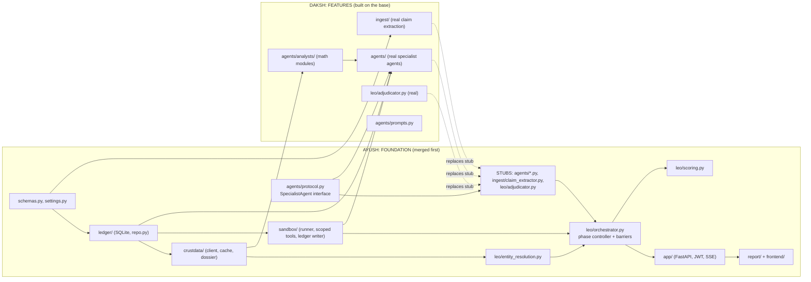

# Leo: Implementation Plan (on-site build, Ayush and Daksh)

Build window: **10:30 AM to 3:30 PM, 31 Oct 2026** (code freeze and submission at 3:30).
Rule from the problem statement: ideas, sketches and blueprints before the event are fine; **no code before 10:30**. The repo is created at 10:30 on site. This file and `docs/architecture-*.md` are the blueprints.

Reference designs: `docs/architecture-high-level.md`, `docs/architecture-low-level.md` (schemas, API calls, math and scoring formulas live there; do not redefine them).

**Assumption: Daksh joins around 12:30.** Ayush builds the foundation alone until then. If Daksh is later, see section 7.

---

## 1. Dependency rule (the whole idea in one line)

**Ayush's code never imports Daksh's code. Daksh's code imports Ayush's code.**
Dependencies run one way only, so Ayush can finish and merge without waiting, and Daksh can build on a stable base whenever he arrives.

How we make that true: Ayush ships **working stubs** for every piece Daksh will later replace. The pipeline runs end to end from the first hour with stub claims and stub agents. Daksh swaps stubs for real implementations, editing only his own files.



---

## 2. Ownership (no shared files after Phase 0)

| | **Ayush: Foundation** | **Daksh: Features** |
|---|---|---|
| Owns | `app/` `ledger/` `crustdata/` `sandbox/` `leo/orchestrator.py` `leo/entity_resolution.py` `leo/scoring.py` `leo/context.py` `report/` `frontend/` `agents/protocol.py` `.github/` `tests/fakes.py` | `ingest/` (real) `agents/analysts/` `agents/identity.py` `scale_team.py` `funding.py` `traction.py` `agents/prompts.py` `leo/adjudicator.py` (real) |
| Tests | ledger, crustdata, entity, sandbox, api, scoring, orchestrator-with-stubs | math, analysts, agents, ingest, adjudicator |
| Branches | `ayush/<task>` | `daksh/<task>` |

Frozen after Phase 0 (change only by agreement, tiny PR): `app/schemas.py`, `app/settings.py`, `ledger/models.sql`, `agents/protocol.py`, `requirements.txt`, `.env.example`, `.gitignore`.

Files Daksh edits are files that exist as **stubs** on day one, so his merges replace content in files Ayush no longer touches.

---

## 3. The contracts

### 3a. Agent interface (`agents/protocol.py`, Ayush writes in Phase 0, Daksh implements)

```python
class SpecialistAgent(Protocol):
    name: str                                   # "identity" | "scale_team" | "funding" | "traction"
    async def run_round1(self, ctx: AgentContext) -> None: ...
    async def run_challenge(self, ctx: AgentContext) -> None: ...
    async def run_reply_verdict(self, ctx: AgentContext) -> None: ...

@dataclass(frozen=True)
class AgentContext:
    run_id: str
    packet: ContextPacket        # this agent's claims + dossier slice + policy (read-only)
    ledger: LedgerWriter         # append-only, bound to this agent's name, also has read helpers
    tools: ScopedCrustdata       # allowlisted Crustdata functions
    llm: LlmClient               # fake in tests, Gemini in prod
```

Stub behaviour (Ayush ships): each stub writes one placeholder finding per claim routed to it, no challenges, and a neutral verdict (score 50, confidence 0.3). So the pipeline, scoring and report all work on day one.

### 3b. Other stubs Daksh later replaces

```python
# ingest/claim_extractor.py       (stub reads tests/fixtures/sample_claims.json)
async def extract_claims(pdf_path: str) -> ClaimSet

# leo/adjudicator.py              (stub returns "No disputes adjudicated.")
async def adjudicate(run_id: str) -> AdjudicationResult

# agents/registry.py              (Ayush owns; lists the 4 agents; Daksh only changes the imports)
def get_agents() -> list[SpecialistAgent]
```

### 3c. Ledger, Crustdata, scoring (Ayush implements)

Same signatures as the low-level doc: `ledger/repo.py` (create_run, set_phase, wait_for_phase, add_claims, add_evidence, add_metrics, add_findings, get_all_findings, add_challenges, get_challenges_for, add_reply, add_verdict, get_verdicts, set_agent_status, add_event, save_decision), `crustdata/client.py` (identify, enrich, job_search, web_search, web_fetch), `crustdata/dossier.py` (build_dossier), `leo/entity_resolution.py` (resolve_company), `leo/scoring.py` (compute).

---

## 4. Ayush: Foundation tasks (in order; merge each when its tests pass)

| # | Time | Task | Files | Done when |
|---|---|---|---|---|
| F0 | 10:30 to 11:00 | Create repo, folder skeleton, `schemas.py`, `models.sql`, `protocol.py`, **all stubs**, `tests/fakes.py` (fake LLM, fake Crustdata), `.env.example`, `requirements.txt`, CI workflow. Capture fixtures: one Enrich call each for 2 known companies, plus a hand-written `sample_claims.json`. Push `main`. | root, `tests/fixtures/` | `pytest` runs, CI green, repo on GitHub |
| F1 | 11:00 to 11:40 | Ledger: SQLite, tables, every `repo.py` function, events, `wait_for_phase` | `ledger/*` | write/read each entity; `wait_for_phase` returns on change and on timeout |
| F2 | 11:40 to 12:25 | Crustdata client: httpx, headers, retry/backoff, `CrustdataError`, read-through cache with TTLs; `build_dossier` | `crustdata/*` | respx tests on fixtures; a repeated call causes one HTTP request |
| F3 | 12:25 to 1:00 | Entity resolution (0.9 accept, 0.5 to 0.9 disambiguate by claims, web fallback, cannot_assess) | `leo/entity_resolution.py` | unit tests: clear match, 0.6 lookalikes, ties, empty |
| F4 | 1:00 to 1:40 | Sandbox (runner, timeout, call cap, `ScopedCrustdata`, `LedgerWriter`) + orchestrator (phase flag, barriers, gate, calls stubs, scoring hook, events) + `context.py` | `sandbox/*` `leo/orchestrator.py` `leo/context.py` | end-to-end run on stubs ends with a saved decision; a forced timeout marks one agent FAILED and the run continues |
| F5 | 1:40 to 2:20 | FastAPI: login (JWT), upload, run status, SSE, report endpoint | `app/*` | 401 without JWT; upload starts a run; SSE streams events |
| F6 | 2:20 to 2:45 | Scoring: formulas, gates, confidence, tiers, check sizing | `leo/scoring.py` | table-driven tests for every gate and tier boundary |
| F7 | 2:45 to 3:10 | Report builder and one-page frontend (login, upload, live feed, verdict, claim table, debate log) | `report/*` `frontend/*` | full run visible in the browser |

Cut line for Ayush: at 2:20 if behind, skip the frontend and render the report as static HTML.

---

## 5. Daksh: Feature tasks (start when he arrives; each task is independent of Ayush's remaining work)

Daksh needs only F0 (stubs, fixtures, fakes, schemas) plus F1 and F2 merged. Everything below can be developed and tested against fixtures and the fake LLM, even if F3 to F7 are not merged yet.

| # | Time (from 12:30) | Task | Files | Done when |
|---|---|---|---|---|
| D1 | 12:30 to 1:10 | Real claim extraction: `pdf_check` (PyMuPDF), send PDF to Gemini as a document with the `ClaimSet` schema, validate, one retry, page-image fallback; `normalize.py` | `ingest/*` | on 2 sample decks, valid claims with topic and slide number |
| D2 | 1:10 to 2:10 | Analyst math modules (priority order: **Funding, Scale, Traction, Identity**). Pure Python, null-safe, formulas exactly as in low-level doc section 8b | `agents/analysts/*` | table-driven tests on the Retool and Zepto fixtures |
| D3 | 2:10 to 2:40 | Real specialist agents: ADK `LlmAgent` per agent with `output_schema`; implement `run_round1`, `run_challenge`, `run_reply_verdict` reading from and writing to the ledger; replace the stubs | `agents/*.py` `agents/prompts.py` | with the fake LLM, 4 agents write findings, challenges, verdicts; with real Gemini, valid JSON |
| D4 | 2:40 to 3:00 | Real adjudicator; prompt tuning so at least one challenge changes a severity on the inflated sample deck | `leo/adjudicator.py` | visible severity change in the demo case |

Cut line for Daksh: at 2:10, if behind, run the debate as one round (challenge and verdict in one call) and keep only Funding and Scale analysts real; Identity and Traction stay on stubs.

---

## 6. Git workflow (built for merges that never conflict)

1. Ayush pushes F0 to `main` first. Daksh clones, branches `daksh/<task>`.
2. Ayush merges each foundation task as soon as its tests pass. Daksh runs `git fetch && git rebase origin/main` at the start of each task.
3. Each task = one branch = one PR. Review quickly, merge, delete the branch.
4. Replacing a stub is a pure content replace in a file only Daksh edits, so rebases are clean.
5. Never edit a file the other person owns. If you need a change there, message them.
6. Frozen files (section 2): change only in a tiny separate PR that both approve.
7. `.env` and the event API key never committed.

Merge checkpoints:

| Time | On `main` |
|---|---|
| 11:00 | F0 (skeleton, stubs, fixtures) |
| 12:25 | F1 ledger, F2 crustdata |
| 1:00 | F3 resolution, D1 ingest |
| 1:40 | F4 orchestrator + sandbox (pipeline works on stubs) |
| 2:20 | F5 API, D2 analysts (mentor checkpoint at 1:30: show the stub pipeline) |
| 2:45 | F6 scoring, D3 real agents: **first real end-to-end run** |
| 3:00 | everything merged, feature freeze |

---

## 7. If Daksh is later than 12:30

| Arrives | Ayush also takes |
|---|---|
| 1:30 | D1 (ingest) at 12:30, since it needs only Gemini and is independent. Daksh starts at D2 |
| 2:15 | D1 and the Funding and Scale analysts; Daksh does D3 and D4 only, using the already merged analysts |
| After 2:30 | Everything stays on stubs except D1 and the Funding analyst; the demo shows the claim table, evidence and verdict; the debate runs in one-round mode with prompts on the stub agents' LLM path |

The foundation guarantees a working demo even if the feature work is partial, because the stubs write valid findings.

---

## 8. Daksh onboarding (first 10 minutes)

1. `git clone`, `python -m venv .venv`, `pip install -r requirements.txt`, copy `.env.example` to `.env`, add the Gemini key.
2. Read `agents/protocol.py` and `tests/fakes.py`. Run `pytest`.
3. Read low-level doc sections 5 (ingestion), 8 (agent functions and math), 9 (debate and scoring).
4. Pick up D1 or D2 on a new branch. Test against `tests/fixtures/*`.

---

## 9. Integration, demo and submission

| Time | Who | What |
|---|---|---|
| 2:45 to 3:05 | Both | Full runs on three demo decks (honest, inflated, fake company); fix only blocking bugs |
| 3:05 to 3:20 | Ayush records, Daksh drives | 2-minute screen recording |
| 3:00 to 3:20 | Daksh | README: what it does, architecture, how to run, honest limits (no EBITDA from Crustdata, revenue is an estimate) |
| 3:20 to 3:30 | Both | Final push, submit repo and video. **Nothing new after 3:20** |

Demo script: problem in one sentence; upload the inflated deck; live agent events; the contradicted ARR claim with Crustdata evidence; a challenge that changed a severity; verdict and policy-based check size; end on "what we could not verify".

---

## 10. Definition of done

- [ ] Repo shared as organizers require, README, `.env.example`, no secrets in history
- [ ] `pytest` and CI green on `main`
- [ ] One command starts the app; one command runs the demo
- [ ] Demo video under 2 minutes
- [ ] Every claim in the report links to evidence with a "data as of" date

## 11. Risks

| Risk | Mitigation |
|---|---|
| Daksh arrives late | Stub-first design (section 1); fallback table (section 7) |
| Interface mismatch | Contracts frozen in F0; Daksh codes against fakes |
| Gemini invalid JSON | Pydantic validation, one retry, then agent marked FAILED |
| Direct PDF input fails | Page-image fallback in D1 |
| Crustdata field null | Every check returns `UNVERIFIABLE`; tested on fixtures |
| Low credits | Cache, fixtures, no live calls in CI |

## 12. Settle at 10:30

1. The three Gemini model names (fast, mid, pro).
2. Whether the event key's field permissions match the test key (`GET /account/endpoints`).
3. When exactly Daksh arrives (updates sections 4 to 7).
4. Whether test decks prepared in advance are acceptable; if unsure, ask a mentor, otherwise write the three decks yourselves in the first hour.
