# Leo: High-Level Architecture and Data Flow (v2)

```mermaid
flowchart TB
    U(["Investor opens website"]) --> UI["Upload screen<br/>pitch deck PDF or PPTX<br/>company name or domain<br/>fund policy: max check, stage"]
    UI --> API["Backend API<br/>creates run_id"]

    subgraph INGEST["1. DECK INGESTION"]
        direction TB
        PARSE["Deck Parser<br/>text per slide + page images<br/>vision model reads charts and tables"]
        CLASS["Slide Classifier<br/>Problem, Market, Traction,<br/>Business model, Team,<br/>Financials, Ask"]
        CLAIMS["Claim Extractor<br/>structured claims with<br/>value, unit, as-of, slide no."]
        PARSE --> CLASS --> CLAIMS
    end
    API --> PARSE

    subgraph LEO1["2. LEO: SETUP"]
        direction TB
        ER["Entity Resolution<br/>Crustdata Identify<br/>0.9 or above accept | 0.5 to 0.9 disambiguate | below that: stop"]
        DOS[("Company Dossier<br/>one Company Enrich call<br/>cached by company id")]
        CTX["Context Packet Builder<br/>claims relevant to each agent<br/>plus its slice of the dossier<br/>plus fund policy"]
        ER --> DOS --> CTX
    end
    CLAIMS --> ER
    ER -- "unresolved" --> STOP["Report: Cannot assess<br/>no verifiable presence"]

    CD["CRUSTDATA API<br/>via gateway with cache and retries<br/>Enrich, Identify, Job Search,<br/>Web Search and Fetch"]
    ER -.-> CD
    DOS -.-> CD

    subgraph SBX["3. ROUND 1: FOUR SANDBOXED AGENTS, RUN IN PARALLEL"]
        direction LR
        subgraph S1["Sandbox A"]
            A1["Identity and Integrity<br/>LLM reasoning"]
            M1["Math: year, HQ, founder<br/>match checks, news flags"]
        end
        subgraph S2["Sandbox B"]
            A2["Scale and Team<br/>LLM reasoning"]
            M2["Math: team size delta,<br/>growth from timeseries,<br/>function mix, review stats"]
        end
        subgraph S3["Sandbox C"]
            A3["Funding and Financials<br/>LLM reasoning"]
            M3["Math: ARR vs revenue band,<br/>revenue per head,<br/>valuation multiple, round check"]
        end
        subgraph S4["Sandbox D"]
            A4["Traction and Momentum<br/>LLM reasoning"]
            M4["Math: openings trend,<br/>traffic QoQ and mix,<br/>follower growth"]
        end
    end
    CTX -- "read-only context packet<br/>one per agent" --> SBX
    SBX -. "allowlisted tools only" .-> CD

    LG[("SHARED EVIDENCE LEDGER<br/>keyed by run_id<br/>tables: evidence, metrics,<br/>findings, challenges, verdicts<br/>append-only, each agent writes<br/>only its own rows")]
    SBX -- "write findings, metrics<br/>and raw evidence" --> LG

    BAR{{"Barrier<br/>all four finished<br/>or timeout"}}
    LG --> BAR

    subgraph R2["4. ROUND 2: SHORT CROSS-EXAMINATION<br/>one pass, time-boxed"]
        direction TB
        RD["Each agent reads the other agents'<br/>findings from the ledger"]
        CH["Up to 2 challenges each<br/>types: contradicts, context,<br/>corroborates, gap<br/>must cite evidence ids"]
        RP["One reply each<br/>concede, rebut, or revise severity"]
        RD --> CH --> RP
    end
    BAR -- "read all findings" --> RD
    RP -- "write challenges, replies,<br/>revised severity" --> LG

    subgraph R3["5. AGENT VERDICTS"]
        direction LR
        V1["Each agent submits<br/>score 0 to 100, confidence,<br/>stance, top 3 flags"]
    end
    LG --> V1
    V1 -- "write verdicts" --> LG

    subgraph LEO2["6. LEO: DECISION"]
        direction TB
        ADJ["Adjudicate open disputes<br/>LLM reasoning, logged"]
        MATH["Math Engine, no LLM<br/>weighted score, hard gates,<br/>confidence factor, check sizing"]
        DEC["Final Decision<br/>Invest, Invest with conditions,<br/>Dig deeper, or Pass<br/>plus policy-based check size"]
        ADJ --> MATH --> DEC
    end
    LG --> ADJ
    LG --> MATH

    subgraph OUT["7. OUTPUT TO USER"]
        direction LR
        RPT["Diligence Brief<br/>verdict, claim vs reality,<br/>signals, culture, debate log,<br/>unverified items,<br/>evidence appendix"]
    end
    DEC --> RPT
    LG --> RPT
    RPT --> U2(["Investor reads the report"])
```

## Where agent results live

The shared Evidence Ledger (SQLite for the hackathon, swappable for Postgres/Supabase) holds every raw evidence snippet, computed metric, finding, challenge and verdict for a run. Agents write only their own rows and cannot touch another agent's. After the barrier they read everyone's rows. The Crustdata response cache is separate and is keyed by endpoint and parameters.

## Sandbox meaning

Each agent is an isolated worker with a read-only context packet, an allowlist of tools (Crustdata gateway only), and write access only through the ledger API to its own namespace. No agent sees another agent's output until the barrier.

## Typical deck format (for the parser)

Mostly PDF, about 10 to 15 slides, in roughly this order: purpose, problem, solution, why now, market size, competition, product, traction, business model, team, financials, ask. PPTX and links are less common. Slides are often image-heavy, so the parser pairs text extraction with page images read by a vision model.
