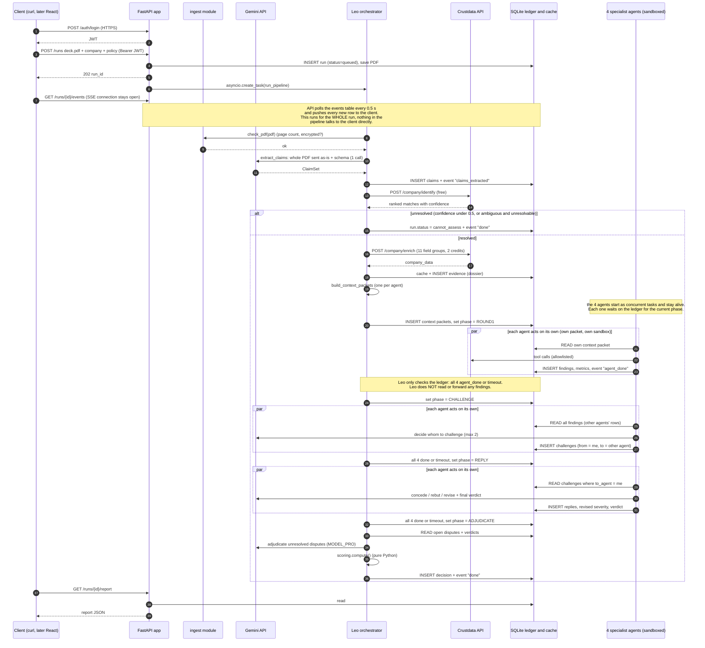
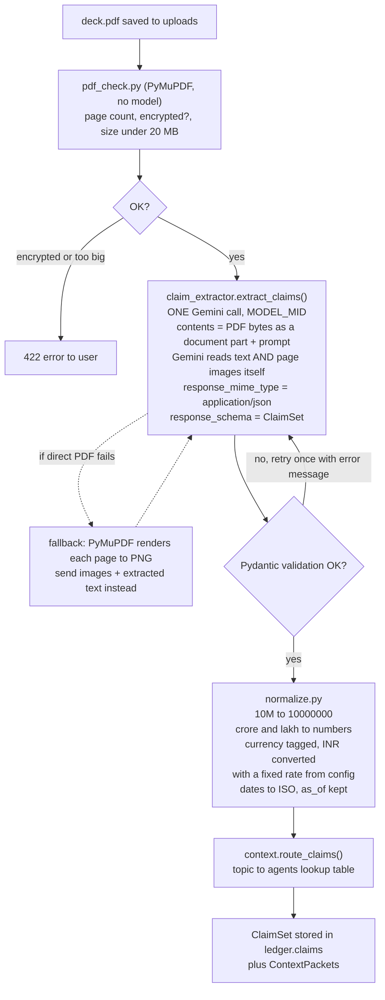
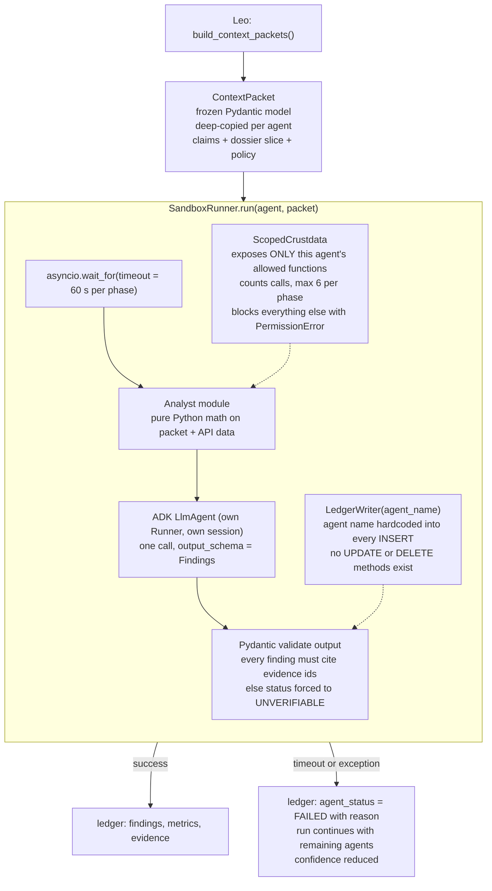
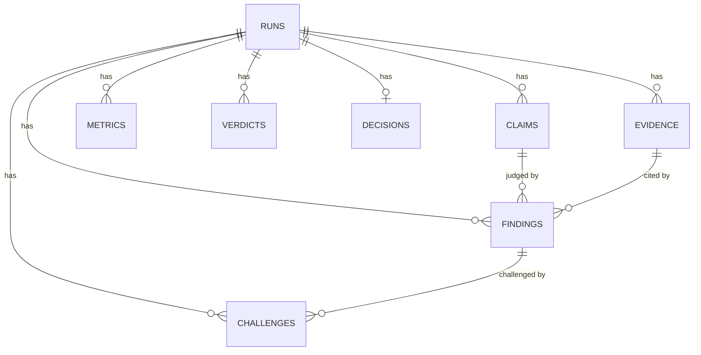
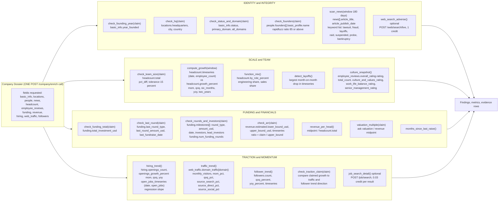
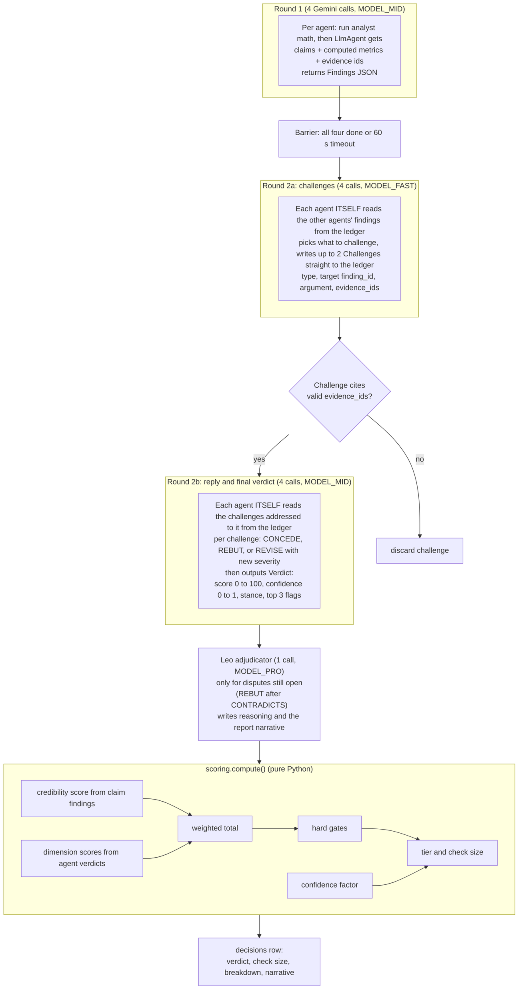
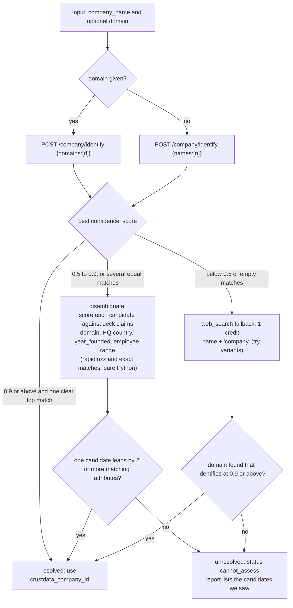

# Leo: Low-Level Design (backend only)

Everything here is backend. Frontend comes later and will only call the HTTP API in section 3.
Field paths in section 8 were checked against a real Crustdata Company Enrich response (Retool).
Items marked VERIFY AT BUILD are things we read in docs but have not run yet.

---

## 0. Decisions (read this first)

| Question | Decision | Why |
|---|---|---|
| Where do we deploy? | **Nowhere for the hackathon. Run locally.** | The problem statement only asks for a functional repo and a 2-minute screen recording. It names no hosting provider and says nothing about Crustdata hosting agents. Deploy later only if time remains (Cloud Run or Render). |
| How are slides classified? | **No separate classifier.** One Gemini call reads the whole deck and returns a list of claims, each tagged with a topic from a fixed list. | Slide order and wording vary, so hard-coding fails. The LLM tags by meaning, not position. See section 4. |
| Orchestration | **Plain Python (`asyncio`) runs the agents as concurrent tasks; Leo only advances a `phase` flag in the ledger.** Leo and the four specialists are ADK `LlmAgent`s. | The debate needs exact control (who goes when, how many rounds). ADK `ParallelAgent` does not share state between branches while running, and its docs say ADK 2.0 supersedes templated workflows. Plain asyncio avoids that risk. |
| Leo to agents transport | **In-process Python function calls**, not HTTP. | Same process, so no network hop to build or fail. |
| Shared result store | **SQLite ledger** (section 7) | One file, no setup. |
| Sandbox | **Software isolation, built by us** (section 6) | Real containers are overkill for 5 hours. The LLM never runs code. Our own Python does all the math. |
| Real-time updates | **HTTPS REST plus Server-Sent Events (SSE)** | One-way progress stream. Simpler than WebSocket. |
| Auth | **JWT (PyJWT, HS256), demo login** | As you said. |
| Math | **Deterministic Python functions**, never the LLM | Reproducible numbers. The LLM interprets them. |

HTTPS note: `uvicorn` on localhost serves HTTP. HTTPS only appears if we deploy or tunnel. Say "JWT-protected API, HTTPS in deployment" and do not claim more.

---

## 1. Tech stack

| Layer | Choice |
|---|---|
| Language | Python 3.11+ |
| API server | FastAPI + uvicorn, `sse-starlette` for SSE |
| LLM framework | Google ADK (`google-adk`) for Leo and the four agents |
| LLM calls outside ADK | `google-genai` (the ingestion call with page images) |
| PDF reading | **Gemini reads the PDF directly** (document input, text and page images together). `pymupdf` only for pre-checks (page count, encrypted) and a fallback if direct upload fails |
| Validation / schemas | Pydantic v2 |
| HTTP client | `httpx` (async) |
| DB | SQLite via `aiosqlite` (ledger + API cache) |
| Fuzzy matching | `rapidfuzz` (founder names, investors) |
| Stats | plain Python plus `statistics` (linear regression slope) |
| Auth | `PyJWT` |
| Tests | `pytest`, `pytest-asyncio`, `respx` (mock httpx) |
| Lint | `ruff` |
| CI | GitHub Actions |
| Config | `.env` via `pydantic-settings` |

Gemini models: you have three. Placeholders below, swap in your real names:
- **MODEL_FAST** (cheapest): Round 2 challenges
- **MODEL_MID**: ingestion and claim extraction (needs vision), Round 1 agents, agent verdicts
- **MODEL_PRO** (strongest): Leo's adjudication and final narrative

---

## 2. Repo layout

```
leo/
  app/
    main.py                 FastAPI app, routes
    auth.py                 JWT create/verify, get_current_user
    settings.py             env config
    schemas.py              Pydantic models (Claim, Finding, Challenge, Verdict, ...)
  ingest/
    pdf_parser.py           parse_deck(path) -> DeckContent
    claim_extractor.py      extract_claims(deck) -> ClaimSet   (1 Gemini call)
    normalize.py            units, currency, dates
  crustdata/
    client.py               identify, enrich, job_search, web_search, web_fetch
    cache.py                read-through cache in SQLite
    dossier.py              build_dossier(company_id) -> Dossier
  leo/
    orchestrator.py         run_pipeline(run_id)
    entity_resolution.py    resolve_company(name, domain, claims) -> Resolution
    context.py              build_context_packets(claims, dossier, policy)
    adjudicator.py          Leo LlmAgent: settles open disputes, writes narrative
    scoring.py              weighted score, gates, confidence, check sizing (no LLM)
  agents/
    base.py                 SpecialistAgent base: run_round1, run_challenge, run_reply_verdict
    identity.py             analyst + LlmAgent config
    scale_team.py
    funding.py
    traction.py
    analysts/               pure-Python math, one module per agent
  sandbox/
    runner.py               SandboxRunner: timeout, allowlist, read-only context
    scoped_tools.py         ScopedCrustdata (allowlisted)
    ledger_writer.py        LedgerWriter bound to one agent name
  ledger/
    db.py                   connection, migrations
    models.sql              DDL (section 7)
    repo.py                 insert/read functions
  report/
    builder.py              ledger -> report JSON -> Markdown/HTML
  tests/
    fixtures/               saved real Crustdata responses (retool, zepto)
    test_*.py
  .github/workflows/ci.yml
```

---

## 3. HTTP API (backend surface)

| Method + path | Auth | Purpose |
|---|---|---|
| `POST /auth/login` | none | body `{username, password}` returns `{access_token}` (JWT, 1h) |
| `POST /runs` | JWT | multipart: `deck` (PDF), `company_name`, `domain` (optional), `max_check_usd`, `stage`. Saves file, creates `run_id`, starts the pipeline as a background task, returns `{run_id}` |
| `GET /runs/{run_id}/events` | JWT | SSE stream of ledger events (agent started, finding written, challenge, verdict, done) |
| `GET /runs/{run_id}` | JWT | status plus final decision when done |
| `GET /runs/{run_id}/report` | JWT | full report JSON (the frontend renders it) |

SSE and JWT: the browser `EventSource` cannot send an `Authorization` header. Use `fetch`-based SSE on the frontend (VERIFY AT BUILD), not a token in the URL.

---

## 4. Diagram A: end-to-end call flow (who calls whom, over what)



Transport per hop:

| Hop | Transport |
|---|---|
| Client to API | HTTPS (HTTP on localhost), JSON, `Authorization: Bearer <JWT>` |
| API to pipeline | in-process `asyncio.create_task` |
| Leo to the four agents | in-process `asyncio.gather` over coroutines (no network) |
| Agents / Leo to Crustdata | HTTPS via `httpx`, headers `authorization: Bearer <key>`, `x-api-version: 2025-11-01` |
| Leo / agents to Gemini | HTTPS via ADK / `google-genai` |
| Everything to ledger | SQLite file via `aiosqlite` |
| Live progress to client | SSE. The API process (not Leo, not the agents) polls the `events` table every 0.5 s and pushes each new row. Events are written at every step: parse, claims, resolve, each agent start and finish, each challenge, verdicts, decision. |

---

## 5. Diagram B: deck ingestion (parser, claim extraction, routing)



Why one LLM call and not a classifier: the model reads all pages together, so "problem on slide 1 or slide 3, in any wording" does not matter. It returns claims, not slide labels.

Claim schema (Pydantic):

```python
class Claim(BaseModel):
    id: str                  # "C1", "C2"...
    topic: Literal["identity_founding","identity_hq","team_size","team_growth",
                   "funding_raised","funding_round","investors","revenue_arr",
                   "revenue_growth","valuation_ask","traction_users",
                   "traction_customers","hiring","product_other"]
    text: str                # verbatim phrase from the deck
    value: float | str | None
    unit: str | None         # "USD", "count", "percent", "year"
    period: str | None       # "YoY", "2025", "last 6 months"
    as_of: str | None
    slide: int
    testable: bool           # False for opinions ("best in class")

class ClaimSet(BaseModel):
    company_name: str | None
    claims: list[Claim]
```

Routing table (code, not LLM):

| Topic | Primary agent | Also sees |
|---|---|---|
| identity_founding, identity_hq | Identity | |
| team_size, team_growth | Scale and Team | |
| funding_raised, funding_round, investors | Funding | Identity (investor names) |
| revenue_arr, revenue_growth, valuation_ask | Funding | Scale (for revenue per head) |
| traction_users, traction_customers, hiring | Traction | Scale (hiring vs headcount) |

Edge cases handled in `pdf_check` and the fallback: password-protected PDF (return 422), more than 30 pages (keep first 30 and note it), scanned or image-only deck (works because Gemini reads page images), PPTX (convert to PDF first, or reject in v1).

---

## 6. Diagram C: the sandbox (built by us)



What the isolation guarantees, stated honestly:
- An agent cannot read another agent's output until the barrier, because it only receives its own packet.
- An agent cannot call tools outside its allowlist.
- An agent cannot overwrite or delete ledger rows, only append its own.
- An agent cannot hang the run: timeout and call cap.
- Not guaranteed: process or memory isolation. That is acceptable because no LLM-generated code is ever executed.

---

## 7. Ledger and cache schema (SQLite)



```sql
CREATE TABLE runs(
  run_id TEXT PRIMARY KEY, user TEXT, company_name TEXT, domain TEXT,
  crustdata_company_id INTEGER, status TEXT,   -- queued|parsing|resolving|round1|round2|scoring|done|cannot_assess|failed
  policy_json TEXT, created_at TEXT);

CREATE TABLE claims(
  run_id TEXT, claim_id TEXT, topic TEXT, text TEXT, value TEXT, unit TEXT,
  period TEXT, as_of TEXT, slide INTEGER, testable INTEGER,
  PRIMARY KEY(run_id, claim_id));

CREATE TABLE evidence(
  run_id TEXT, evidence_id TEXT, agent TEXT, source TEXT,     -- 'crustdata.company.enrich' ...
  field_path TEXT,            -- 'revenue.estimated.upper_bound_usd'
  value_json TEXT, fetched_at TEXT, crustdata_updated_at TEXT,
  PRIMARY KEY(run_id, evidence_id));

CREATE TABLE metrics(
  run_id TEXT, agent TEXT, name TEXT, value REAL, unit TEXT, formula TEXT,
  evidence_ids TEXT, PRIMARY KEY(run_id, agent, name));

CREATE TABLE findings(
  run_id TEXT, finding_id TEXT, agent TEXT, claim_id TEXT,    -- claim_id null for agent-originated flags
  status TEXT,                -- VERIFIED|PARTIAL|CONTRADICTED|UNVERIFIABLE
  severity INTEGER,           -- 1..5, initial
  severity_final INTEGER,     -- after debate
  note TEXT, evidence_ids TEXT, round INTEGER,
  PRIMARY KEY(run_id, finding_id));

CREATE TABLE challenges(
  run_id TEXT, challenge_id TEXT, from_agent TEXT, to_agent TEXT, finding_id TEXT,
  type TEXT,                  -- CONTRADICTS|CONTEXT|CORROBORATES|GAP
  argument TEXT, evidence_ids TEXT,
  reply_action TEXT,          -- CONCEDE|REBUT|REVISE
  reply_text TEXT, new_severity INTEGER,
  PRIMARY KEY(run_id, challenge_id));

CREATE TABLE verdicts(
  run_id TEXT, agent TEXT, score REAL, confidence REAL, stance TEXT,
  flags_json TEXT, PRIMARY KEY(run_id, agent));

CREATE TABLE decisions(
  run_id TEXT PRIMARY KEY, total_score REAL, confidence REAL, verdict TEXT,
  gates_json TEXT, check_size_usd REAL, narrative TEXT, breakdown_json TEXT);

CREATE TABLE agent_status(
  run_id TEXT, agent TEXT, phase TEXT, state TEXT, error TEXT, started_at TEXT, ended_at TEXT,
  PRIMARY KEY(run_id, agent, phase));

CREATE TABLE api_cache(
  cache_key TEXT PRIMARY KEY,   -- sha256(endpoint + sorted params + api_version)
  endpoint TEXT, response_json TEXT, fetched_at TEXT, ttl_seconds INTEGER);
```

How one agent's result reaches another: agents never pass objects to each other. Agent X inserts `findings`. After the barrier, `repo.get_all_findings(run_id)` returns every agent's rows to Round 2.

Cache TTLs: identify 30 days, enrich 24 h, job search 24 h, web search 6 h.

---

## 8. Diagram D: the four agents at function level (what they call, what they get, what they compute)



### 8a. Exact Crustdata calls (all headers: `authorization: Bearer <key>`, `x-api-version: 2025-11-01`, `content-type: application/json`)

| Function (`crustdata/client.py`) | HTTP | Request body | Response fields we use | Cost |
|---|---|---|---|---|
| `identify(names=None, domains=None)` | `POST /company/identify` | `{"names":["Retool"]}` or `{"domains":["retool.com"]}`, one array only, max 25 | top-level list; each item: `matched_on`, `matches[].confidence_score`, `matches[].company_data.basic_info.{name, primary_domain, crustdata_company_id, employee_count_range}`. Empty `matches` = no match | free |
| `enrich(domain=None, company_id=None, fields=[...])` | `POST /company/enrich` | `{"domains":["retool.com"],"fields":["basic_info","locations","people","news","headcount","employee_reviews","funding","revenue","hiring","web_traffic","followers"]}` | list; take `[0].matches[0].company_data` (see field list below) | 2 |
| `job_search(company_id, title_filter=None, limit=50)` | `POST /job/search` | `{"filters":{"op":"and","conditions":[{"field":"company.basic_info.company_id","type":"=","value":<id>}]},"fields":["job_details.title","job_details.url","metadata.date_added","location.raw"],"sorts":[{"field":"metadata.date_added","order":"desc"}],"limit":50}` | `job_listings[]`, `next_cursor`, `total_count` (can be null) | 0.03 per result |
| `web_search(query, sources=["web","news"], start_date=None)` | `POST /web/search/live` | `{"query":"Retool lawsuit OR fraud","sources":["news"]}` | `results[].{source,title,url,snippet,position}`, `metadata.total_results` | 1 per query |
| `web_fetch(urls)` | `POST /web/enrich/live` | `{"urls":["https://..."]}` max 10 | list of `{success,url,title,content(html)}`; failed entries have `url: null` | 1 per page |

Real `company_data` field paths seen in the live Retool response:
- `basic_info.{status,name,primary_domain,all_domains,website,description,company_type,year_founded,employee_count_range}`
- `locations.{city,state,country,headquarters,street_address,all_office_addresses}`
- `headcount.{total, growth_percent.{mom,qoq,six_months,yoy,two_years}, growth_absolute.{...}, by_role_absolute, by_role_percent, by_role_growth_6m_pct, by_role_growth_yoy_pct, timeseries[{date,employee_count}], by_function_timeseries}`
- `funding.{total_investment_usd, last_round_amount_usd, last_round_type, last_fundraise_date, num_funding_rounds, investors[], investors_detailed[], milestones[{round_type,amount_usd,date,investors,lead_investors}]}`
- `revenue.estimated.{lower_bound_usd, upper_bound_usd, timeseries[{date,revenue_lower_bound_usd,revenue_upper_bound_usd}]}`
- `hiring.{openings_count, openings_growth_percent.{mom,qoq,yoy}, by_function_qoq_pct, by_function_6m_pct, open_jobs_timeseries[{date,open_jobs}], recent_titles_csv}`
- `web_traffic.domain_traffic.<domain>.{monthly_visitors, mom_pct, qoq_pct, source_search_pct, source_direct_pct, source_social_pct, ...}`
- `followers.{count, mom_percent, qoq_percent, six_months_growth_percent, yoy_percent, timeseries[{date,follower_count}]}`
- `employee_reviews.{overall_rating.{rating,total_count,rating_1_count..rating_5_count}, culture_and_values_rating, work_life_balance_rating, senior_management_rating, career_opportunities_rating, compensation_and_benefits_rating}`
- `people.{founders[], cxos[], decision_makers[]}`, each with `basic_profile.{name,current_title,headline}`, `experience`, `education`
- `news[{article_title, article_publish_date, article_publisher_name, article_url, source}]`

Corrections to our earlier notes (from the live data): funding rounds come as `funding.milestones`, not `funding_rounds`. `growth_percent` is already in percent units (yoy -10.41 means -10.4 percent). Any group can come back null: every check function must return `UNVERIFIABLE` on null, never raise.

### 8b. The math (all in `agents/analysts/`)

```
pct_diff(claim, actual)      = (claim - actual) / actual
team_size verdict            : |pct_diff| <= 0.15 VERIFIED; <= 0.40 PARTIAL; else CONTRADICTED
own_growth(window_months)    = (hc_now - hc_then) / hc_then   from headcount.timeseries
growth claim verdict         : compare claim to own_growth; tolerance +-10 percentage points
layoff flag                  : any month-on-month drop > 15 percent in last 12 months
arr_ratio                    = claimed_arr / revenue.upper_bound_usd
arr verdict                  : ratio <= 1.0 VERIFIED; <= 1.5 PARTIAL; > 3.0 CONTRADICTED (critical gate)
rev_per_head                 = ((lower + upper) / 2) / headcount.total
rev_per_head flag            : > 600,000 USD or < 20,000 USD is implausible, severity 3
val_multiple                 = ask_valuation / revenue_midpoint
val_multiple flag            : > 50x midpoint, severity 3 (config table, labelled as heuristic)
months_since_raise           = months between today and funding.last_fundraise_date
round claim verdict          : type equal and amount within 10 percent VERIFIED
founder match                : rapidfuzz.fuzz.token_sort_ratio >= 85
hiring slope                 = least-squares slope of open_jobs_timeseries (last 6 points)
traffic quality              = source_direct_pct + source_search_pct   (low = paid-heavy)
```

---

## 9. Diagram E: debate, verdicts, scoring



Gemini call budget per run: 1 (extraction) + 4 + 4 + 4 + 1 = **14 calls**.

Scoring formulas:

```
status_credit      : VERIFIED 1.0 | PARTIAL 0.5 | CONTRADICTED 0.0
UNVERIFIABLE       : excluded from credibility, lowers confidence
materiality(claim) : funding/revenue/team_size 5 | growth/traction 4 | identity 3 | other 2
credibility        = 100 * sum(materiality * status_credit) / sum(materiality)   over verifiable claims

severity_penalty   = 6 * (severity_final - 1)       # per CONTRADICTED finding; applied inside each agent's score
total_score        = 0.35*credibility + 0.25*momentum(A4 score) + 0.20*financial(A3 score)
                   + 0.10*team_culture(A2 score) + 0.10*integrity(A1 score)

confidence         = 0.5*verifiable_claim_share + 0.3*mean(agent confidences) + 0.2*(agents_succeeded / 4)

HARD GATES (any one => verdict capped at PASS):
  entity unresolved
  founder named in deck not found in people.founders
  claimed funding round absent from funding.milestones
  arr_ratio > 3.0
  entity status != "active"

tier:   total >= 80 and no gate and no severity-5 finding -> INVEST
        65..79                                          -> INVEST_WITH_CONDITIONS
        50..64                                          -> DIG_DEEPER
        < 50 or any gate                                -> PASS
EBITDA / profit never available from Crustdata: INVEST is downgraded to INVEST_WITH_CONDITIONS
until founder documents arrive (always listed under "must obtain").

check_size_usd = policy.max_check_usd * tier_pct * confidence
tier_pct       : INVEST 1.0 | INVEST_WITH_CONDITIONS 0.5 | DIG_DEEPER 0.0 | PASS 0.0
```

Report label on check size: "policy-based sizing from the fund's own rules, not financial advice."

---

## 10. Diagram F: entity resolution (the gate)



Live test result that motivates this: a fake name returned three lookalike matches at confidence 0.6, and "Zepto" returned several companies at confidence 1.0 with different domains. Confidence alone is not enough, so disambiguation against the deck is required.

---

## 11. Auth, errors, retries

- `POST /auth/login`: compare against `DEMO_USER` and `DEMO_PASS_HASH` from `.env` using `secrets.compare_digest`; issue `jwt.encode({"sub": user, "exp": now+1h}, JWT_SECRET, "HS256")`.
- `get_current_user` FastAPI dependency decodes the token on every route; invalid or expired gives 401.
- Crustdata errors: retry 429 and 5xx with exponential backoff (1 s, 2 s, 4 s, max 3). Respect rate limit headers. 402 (insufficient credits) fails the run with a clear message. Normalize all errors into `CrustdataError(kind, status, message)`.
- Gemini errors: retry once on invalid JSON or schema failure, with the validation error appended; then mark that agent FAILED.
- Never log the API key or JWT secret. Both only from `.env`, which is git-ignored.
- Credit budget: 200 credits on the test key. One run costs about 2 (enrich) + up to 2 (web searches) + 1.5 (job search). Cache everything, and develop against saved fixtures.

---

## 12. Tests and CI

Fixtures: save the real Retool and Zepto enrich responses as `tests/fixtures/*.json`, plus 3 invented decks (honest, inflated, fake-company).

| Test | Asserts |
|---|---|
| `test_math.py` | pct_diff, arr_ratio, growth from timeseries, slope, layoff detection (pure functions, table-driven) |
| `test_agents_checks.py` | each check function returns the right status for matching, partial, contradicting, null data |
| `test_scoring.py` | gates cap the verdict, confidence shrinks the check size, EBITDA downgrade |
| `test_entity_resolution.py` | 0.9 accept, 0.6 lookalikes go to disambiguation, empty gives cannot_assess |
| `test_ledger.py` | LedgerWriter cannot write another agent's name, no update or delete methods |
| `test_sandbox.py` | timeout marks FAILED, disallowed tool raises, run continues with 3 agents |
| `test_api.py` | 401 without JWT, login works, upload creates a run (Crustdata and Gemini mocked with `respx` and a fake LLM) |
| `test_pdf_check.py` | text PDF, image-only PDF, encrypted PDF, oversize PDF |

CI (`.github/workflows/ci.yml`): on push and PR: set up Python 3.11, `pip install -r requirements.txt`, `ruff check .`, `pytest -q`. No live API calls in CI. CD later.

---

## 13. Open items to confirm at build time (VERIFY AT BUILD)

1. Which three Gemini model names you have (fill MODEL_FAST, MODEL_MID, MODEL_PRO).
2. The ADK package version that installs cleanly, and that `LlmAgent` with `output_schema` works for your chosen models. ADK docs say `output_schema` should not be combined with `tools` on models that do not support it; our agents use tools only in the analyst step in Python, so they stay compatible.
3. Whether the final hackathon API key has the same field permissions as the test key (`GET /account/endpoints`).
4. Current Crustdata field names on one more company with sparse data, to confirm null handling.
5. `google-genai` structured output call signature for the ingestion step.
